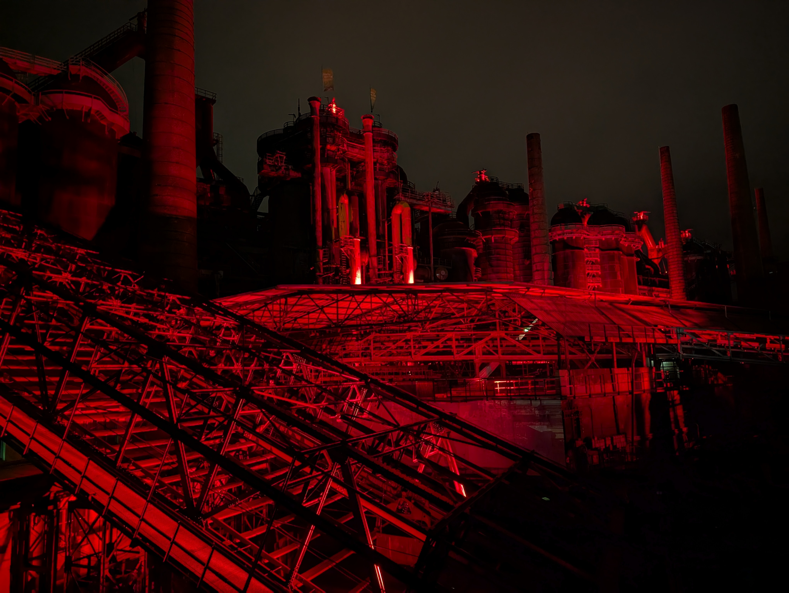
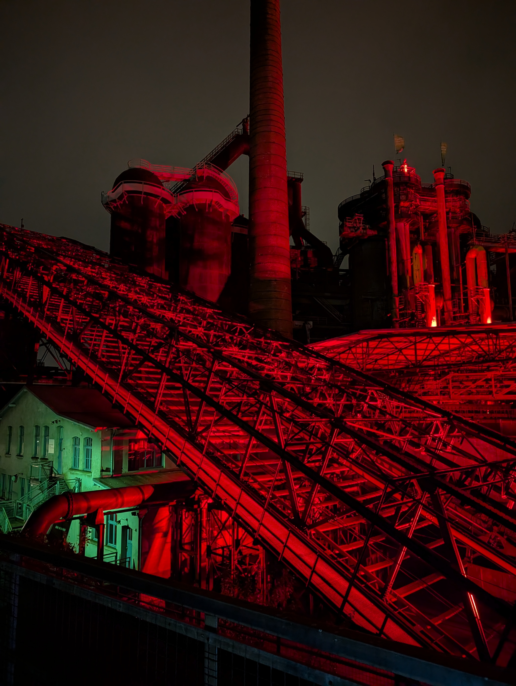
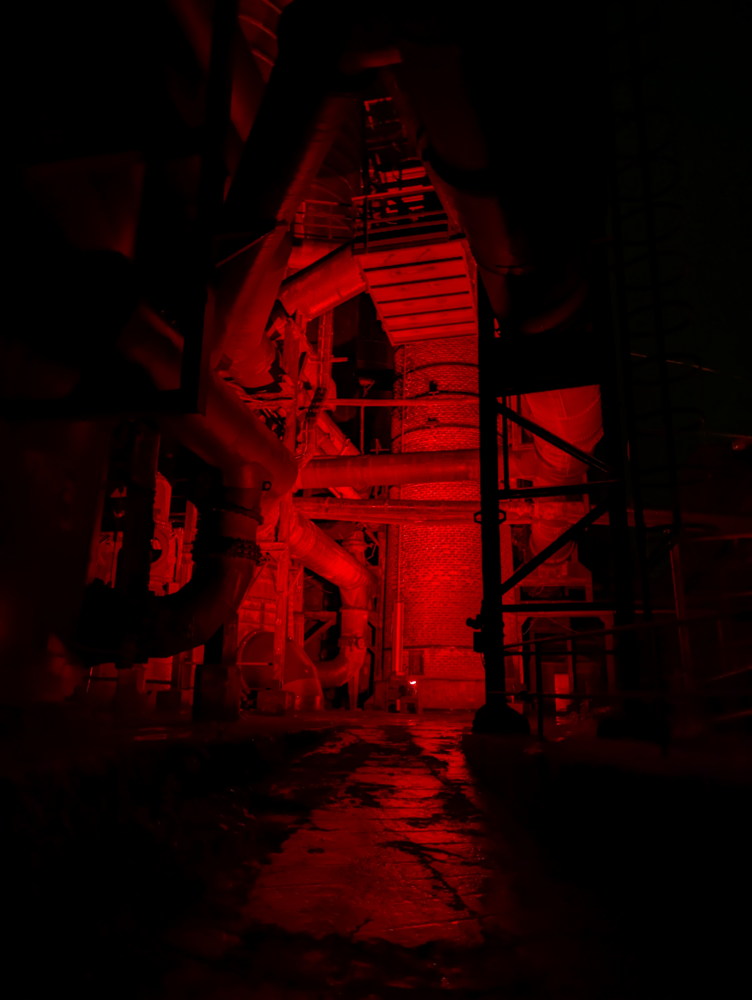

Heute gab es einen Termin, einen Ausflug in die Dunkelheit und ein neues Bastelprojekt.

## Frisch frisiert

Heute Nachmittag hatte ich mal wieder einen Friseurtermin. Jetzt ist erst einmal wieder Ruhe. :)

## Völklinger Hütte bei Nacht

Am Abend habe ich zusammen mit Hanna und einer ihrer Schulfreundinnen an einer Taschenlampenführung durch die Völklinger Hütte teilgenommen. Dort war ich ja erst [letzten Samstag](/logbuch/2026-11-14/#ein-tag-in-der-völklinger-hütte) mit unserem Besuch.

Der Start war allerdings alles andere als einladend: Das Wetter war zu Beginn richtig schlecht, und nach kurzer Zeit waren wir alle klatschnass. Zum Glück wurde es im Laufe der Tour besser.

Trotzdem war es eine tolle Erfahrung - im Licht der Taschenlampen wirkt die Hütte ganz anders, als wenn man tagsüber durch die Anlage läuft.





## Pillbox: Tabletten im Blick

Ich habe ein neues kleines Projekt für Home Assistant gestartet. Es heißt [Pillbox](https://github.com/FdyFox/pillbox) und soll uns in der Familie helfen, unsere Tabletten besser zu tracken - vor allem, ob sie genommen wurden und wie viele noch da sind.
