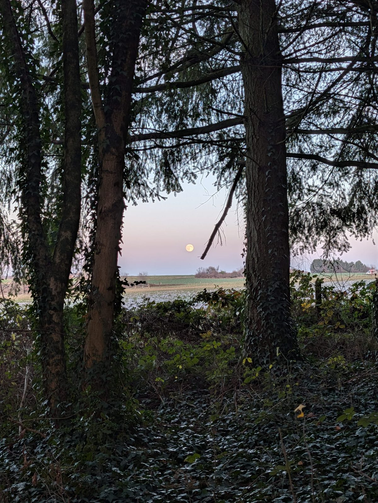
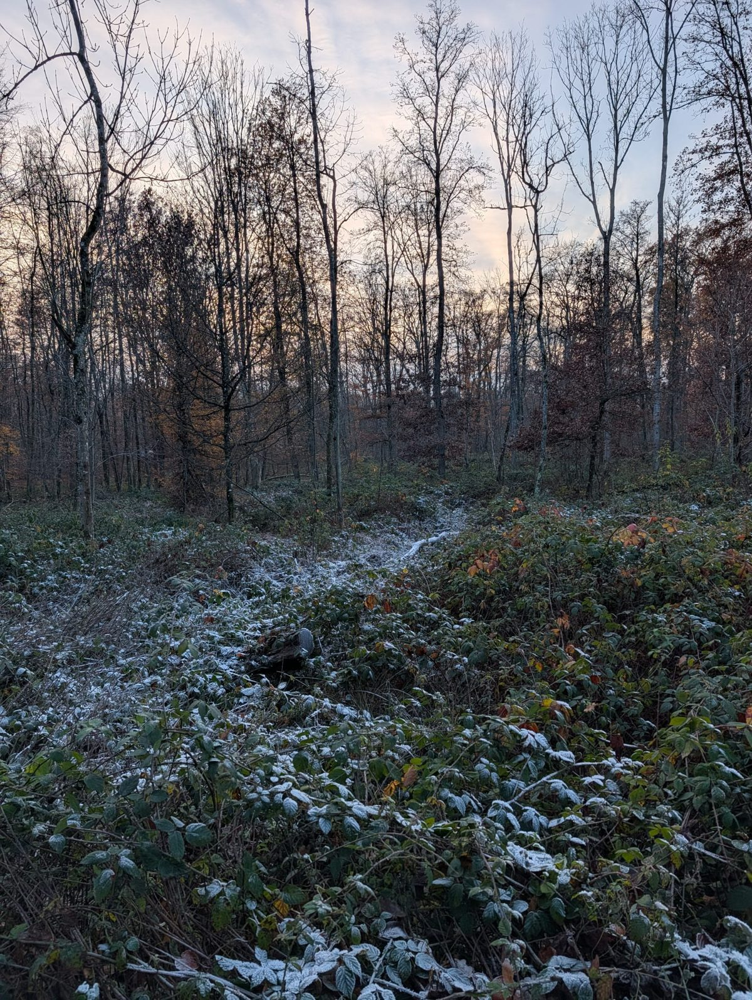
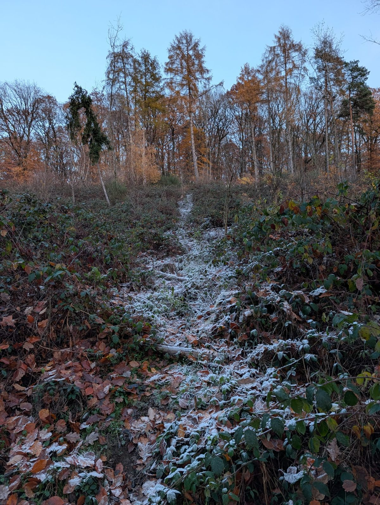

Der Tag hat nicht gut angefangen, dafür aber umso schöner aufgehört.

## Migräne, die Zweite

Eigentlich hatte ich gehofft, dass die [Migräne von gestern](/logbuch/2026-11-23/#migräne-zum-wochenstart) über Nacht verschwindet - leider war sie heute Morgen wieder da. Ich habe es trotzdem irgendwie geschafft, die Kinder zu versorgen, meine Triptane zu nehmen und sogar noch etwas zu frühstücken.

## Raureif am Nachmittag

Später bin ich dann doch noch mit den Hunden und den Kindern rausgekommen, in den Wald bei uns ums Eck. [Letzte Woche](/logbuch/2026-11-17/#herbst-im-wald) sind wir dort durch buntes Herbstlaub gelaufen.

Diesmal sah es ganz anders aus: Obwohl die Sonne längst tief stand, lagen auf den Brombeeren und dem Laub immer noch Reste vom Frost der Nacht. Der Winter klopft also langsam an. Zwischen den Bäumen hindurch war über den Feldern sogar der Mond zu sehen.





## Sonja: Endlich wieder zu Hause

Nach zwei Tagen [in Emmendingen](/logbuch/2026-11-22/#sonja-zurück-nach-emmendingen) ist Sonja heute endlich wieder nach Hause gekommen. Die Kinder und ich haben uns sehr gefreut - und ich bin ehrlich gesagt auch froh, nach den Migränetagen wieder Unterstützung zu haben. :)
